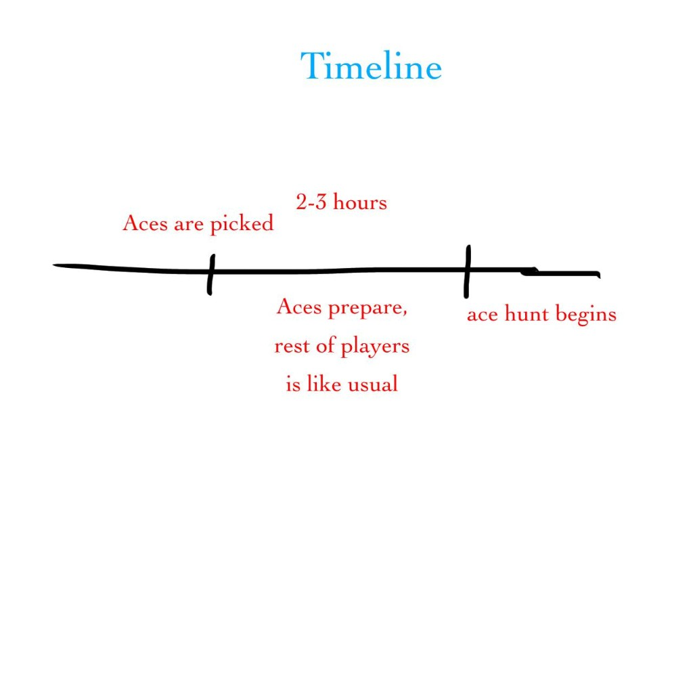

# Ace Hunt (Day 3)

**Status:** Event design **Confirmed** from Karim’s Day 3 notes. Plugin systems **Implemented** on `feature/ace-hunt`. Map build (territories / bedrock lockup) remains ops.

## Timeline

1. **Aces are picked** (one player per team) via `/larp acehunt ace`.
2. **2–3 hours** prep (`/larp acehunt prep`): aces are teleported to their territory with a per-player world border; the rest of the server plays as usual. Prep length is ops/schedule (no plugin timer).
3. **Ace hunt begins** (`/larp acehunt begin`).

## Core loop

- Each team hunts **another team’s ace** (`/larp acehunt hunt` or `/larp acehunt cycle`).
- After a timed hunt window (default **18 minutes**, configurable; suggestion range 15–20), aces get **1 minute to surface**, then underground becomes banned.
- Points for:
  - Your hunt of an ace (placement-based: first / second / third kill)
  - Your ace’s survival (placement-based: died first / second / last)
- **Point table (shipped default):** `2 / 1 / 0` for both hunt and survival placements. Matches Karim’s example: first hunt kill + longest survival → **2 + 2 = 4**. Values live in `config.yml` under `ace-hunt.points`.
- Placements from points; on a tie, both teams get the award for the **worse** (lower) placement.
- On-screen counter: **boss bar** (sidebar is already full).

## Player rules

| Rule | Detail |
|------|--------|
| Loot | You **can** collect and keep blocks/resources from the ace hunt map |
| Respawn | Non-aces respawn in a **bedrock box** (map-built; plugin confines) for **3 minutes**, then return to the hunter spawn |
| Inventory | **Keep inventory on** for event participants only (not the world gamerule) |
| Skybase | **Cannot** skybase — block place above per-territory `max-legal-y` is cancelled |
| Dead ace’s hunters | When the assigned hunting team’s ace target dies, those hunters go to **spectator** (their own ace keeps playing) |
| Ace death | When an ace dies during hunt/surface/ban, they go to **spectator** |
| Underground ban | After the surface minute, participants below territory `surface-y` take damage and cannot break/place |

## Territory vs world border

**Resolved for this branch:** do not move the server world border. Admins define one cuboid per team. Participating players get a **per-player world border** around that cuboid so ace islands can sit outside the main border. Cuboid clamp still blocks pearls / corners. The plugin does not paste or delete terrain.

## Economy / kill money

**Resolved for this branch:** kill money is **off** for Ace Hunt participants via event scope `ace-hunt`. Aces are registered at prep; hunters are added at begin. Event deaths are marked `event_kill` and stay off `/top kills`. No dollar prize payout for Ace Hunt points in v1.

## Admin commands

`/larp acehunt …` — `ace`, `hunt`, `cycle`, `define`, `spawn`, `y`, `lockup`, `prep`, `begin`, `stop`, `status`, `reload`.

## Relation to calendar

See [Events overview](overview-and-calendar.md). Ace Hunt is the Day 3 centerpiece in the current design.
