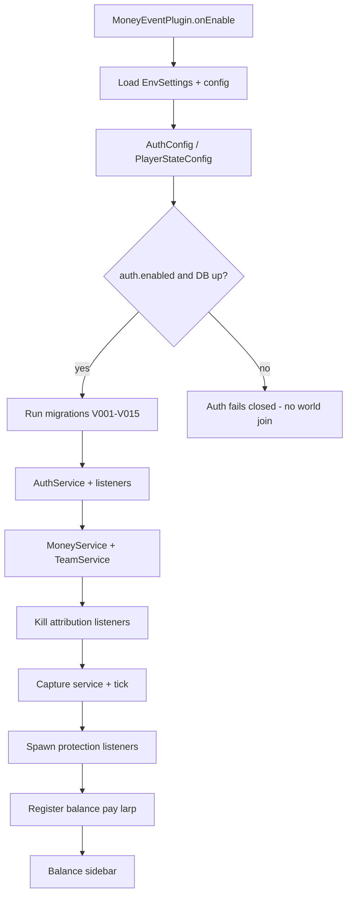

# System overview

**Status:** Describes **Implemented** architecture on `main` unless marked Planned.

## Stack

| Layer | Choice |
|-------|--------|
| Game | Minecraft Java 1.21.11 |
| Server | Paper (`paper-api:1.21.11-R0.1-SNAPSHOT`) |
| Plugin | `MoneyEvent` (`com.larpsmp.moneyevent`) |
| Language | Java 21 |
| Build | Gradle Wrapper 9.8.0 |
| Database | PostgreSQL 16+ (Docker Compose locally) |
| Pool | HikariCP |
| Email | Resend (signup verify + recovery) |
| Password hashing | Argon2id (BouncyCastle) |

Runtime JDBC / Hikari / BouncyCastle are declared under `plugin.yml` `libraries:` so Paper downloads them at startup.

## Package map

Root: `src/main/java/com/larpsmp/moneyevent/`

| Package | Responsibility |
|---------|----------------|
| `(root)` `MoneyEventPlugin` | Lifecycle, wiring, autosave task |
| `auth` | Pre-join dialogs, accounts, UUID binding, rate limits, admin authorizers |
| `acehunt` | Day 3 Ace Hunt (prep/hunt phases, scoring, lockup, borders, boss bar) |
| `gladiator` | Day 4 Gladiators (arena fights, kits, quota, kit bans, boss bar, payout) |
| `auction` | Mystery shulker auctions (/bid, /auction pay, reps, lot lifecycle) |
| `capture` | Capture points (occupancy, progress, temp blocks, boss bar) → capture reward |
| `combat` | Kill attribution (60s last-attacker, traps/hazards) → death settlement |
| `spawn` | Respawn-only player-damage immunity + unbreakable spawn blocks |
| `command` | `/balance`, `/pay`, `/larp` bridge; join listener; player lookup |
| `config` | `.env` / `EnvSettings` |
| `db` | Datasource factory, migration runner |
| `display` | Stacked sidebar HUD (top teams/players + wallet) + team nametags / tab grouping |
| `email` | Resend client + templates |
| `notification` | Offline `/pay` notifications (plugin data folder) |
| `playerstate` | Account-keyed body persist/load/session + universal account identity binding |
| `team` | Teams, captains, tiers, admin dialogs |
| `wallet` | `MoneyService`, JDBC ledger |

## Startup wiring (simplified)

Authoritative wiring lives in [`MoneyEventPlugin.java`](../../src/main/java/com/larpsmp/moneyevent/MoneyEventPlugin.java).

## Commands registered

From [`plugin.yml`](../../src/main/resources/plugin.yml):

| Command | Role |
|---------|------|
| `/balance [player]` | Public balances |
| `/pay <player> <amount>` | Transfers |
| `/larp …` | Admin money + capture + spawn + auction + ace hunt + gladiators + teams (`money`, `capture`, `spawn`, `auction`, `acehunt`, `gladiators`, `teams`, `team`, `captain`, `tier`) |
| `/gladiator` | Gladiators quota / points; kit ban during 1v1s |

## Cross-cutting principles

- **Account ID** is the persistence key; Minecraft UUID/name are bind + display.
- **Money mutations** must go through `MoneyService` (do not edit wallet rows from event code).
- **Teams** are the roster source of truth; economy queries teams rather than duplicating membership.
- **Authorizer:** `AccountPermissionAuthorizer` — console, plugin admin (`/larp op`), or server operator (`/larp serverop`). Bukkit op syncs from server-operator grants only.

## Roles (Implemented)

Competitor / spectator on `account_participation`. Plugin admin on `account_plugin_admins`. Server operator on `account_server_operators`.

Auctions, Ace Hunt, and Gladiators packages are Implemented.
