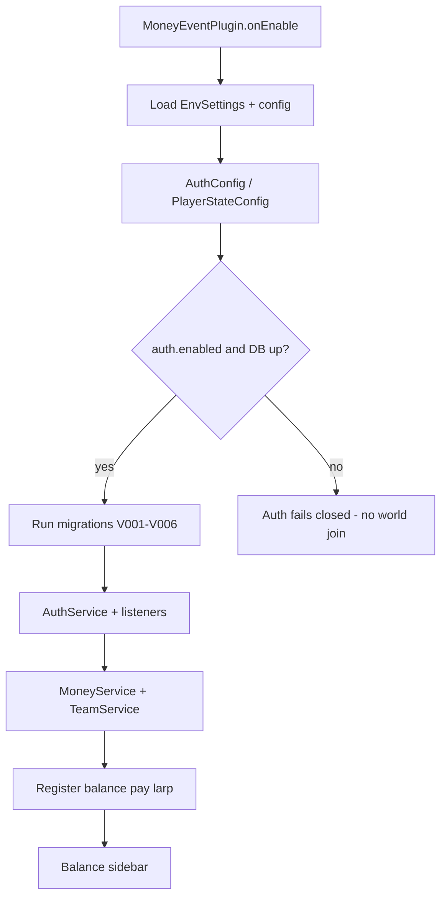

# System overview

**Status:** Describes **Implemented** architecture on `feature/teams` unless marked Planned.

## Stack

| Layer | Choice |
|-------|--------|
| Game | Minecraft Java 1.21.11 |
| Server | Paper (`paper-api:1.21.11-R0.1-SNAPSHOT`) |
| Plugin | `MoneyEvent` (`com.larpsmp.moneyevent`) |
| Language | Java 21 |
| Build | Gradle Wrapper 9.8.0 |
| Database | PostgreSQL 16+ (Docker Compose locally) |
| Pool | HikariCP |
| Email | Resend (signup verify + recovery) |
| Password hashing | Argon2id (BouncyCastle) |

Runtime JDBC / Hikari / BouncyCastle are declared under `plugin.yml` `libraries:` so Paper downloads them at startup.

## Package map

Root: `src/main/java/com/larpsmp/moneyevent/`

| Package | Responsibility |
|---------|----------------|
| `(root)` `MoneyEventPlugin` | Lifecycle, wiring, autosave task |
| `auth` | Pre-join dialogs, accounts, UUID binding, rate limits, admin authorizers |
| `command` | `/balance`, `/pay`, `/larp` bridge; join listener; player lookup |
| `config` | `.env` / `EnvSettings` |
| `db` | Datasource factory, migration runner |
| `display` | Balance sidebar HUD |
| `email` | Resend client + templates |
| `notification` | Offline `/pay` notifications (plugin data folder) |
| `playerstate` | Account-keyed body persist/load/session |
| `team` | Teams, captains, tiers, admin dialogs |
| `wallet` | `MoneyService`, JDBC ledger |

## Startup wiring (simplified)

Authoritative wiring lives in [`MoneyEventPlugin.java`](../../src/main/java/com/larpsmp/moneyevent/MoneyEventPlugin.java).

## Commands registered

From [`plugin.yml`](../../src/main/resources/plugin.yml):

| Command | Role |
|---------|------|
| `/balance [player]` | Public balances |
| `/pay <player> <amount>` | Transfers |
| `/larp …` | Admin money + teams (`money`, `teams`, `team`, `captain`, and in code `tier`) |

Note: `plugin.yml` usage text currently omits `tier`; the command is Implemented via `TeamCommandController`.

## Cross-cutting principles

- **Account ID** is the persistence key; Minecraft UUID/name are bind + display.
- **Money mutations** must go through `MoneyService` (do not edit wallet rows from event code).
- **Teams** are the roster source of truth; economy queries teams rather than duplicating membership.
- **Dev authorizer:** `DevelopmentConsoleOpAuthorizer` (console/op) — temporary until production authz adapter lands.

## Intentionally not in this codebase yet

Capture progress engine, kill attribution, death/rescue settlement, auctions, Ace Hunt, Gladiators automation, `/top` leaderboards, competitor role flags, production permission model.
